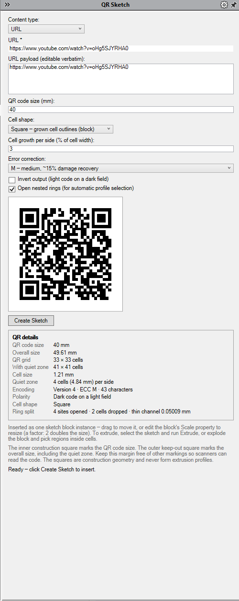
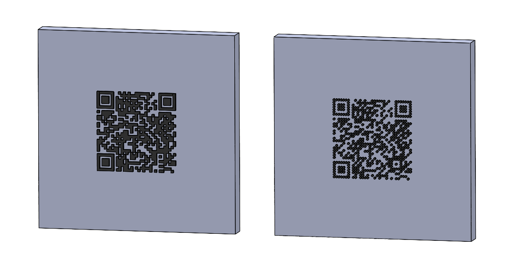

# SolidWorks QR Add-In

A free, open-source **SolidWorks add-in** that generates a **native QR code
sketch** — real contour geometry on a selected plane or planar face, ready
to extrude, emboss, engrave, or laser-mark. No image tracing, no imported
bitmaps, no macros to babysit.

*(The QR images below are the add-in's own preview renders — the same grown
contour geometry the sketch gets, pixel-for-pixel.)*

## Features

- **Native sketch output** — closed contours on the selected reference plane
  or planar face, left open in edit mode; a docked task-pane UI with live
  preview that renders the exact delivered geometry
- **Square or circle modules** — classic module squares, or true-dot pattern
  for marking
- **Growth compensation and invert** — module edge growth for
  manufacturing/marking, plus inverted (light-cell) polarity
- **ECC level** L/M/Q/H, automatic version selection
- **Content modes** — Raw text, URL, WiFi, Contact (vCard), E-mail, SMS,
  Phone call, Geolocation, and SW Properties (payload resolved from the
  active part's custom properties via `$PRP` templates)
- **Open nested rings** (opt-in) — thin corner slits through the three
  finder rings plus module-aligned cell drops open every island-bearing
  void, so SolidWorks' automatic profile selection can extrude the code
  without manually picking profiles
- Named undo, insertion-limit guards with actionable errors

## Screenshots

| | |
|---|---|
| **Task pane** — live preview renders the exact delivered geometry; the QR details block reports the resolved grid, cell size, and ring-split treatment: |  |
| **Open nested rings** — the split code looks identical at code scale: |  |
| **Finder slit, zoomed** — a ~0.05 mm channel at the ring corner, hugging the inner edge, opens the nested ring: |  |
| **Inverted polarity** — light cells emit; egress vents through the quiet zone by the same thin channel: |  |
| **Circle shape** — true-dot modules for marking/engraving: |  |
| **Extruded** — boss extrusions straight off the sketches, square (left) and circle (right): |  |

## Square vs. circle

The two cell shapes produce different sketch anatomy:

- **Square** — the code is inserted as a single **sketch block instance**.
  Drag the block to move the code; edit the instance's **Scale** property
  to resize (a multiplier — 2 doubles it).
- **Circle** — dots emit as a two-directional **linear sketch pattern**
  with non-emitting instances skipped. The sketch is **fully dimensioned
  and equation-driven**: pattern spacing, dot diameter, seed offsets and
  the quiet-zone square all derive from one driving dimension on the QR
  square — edit it and the code rescales parametrically.

In both shapes the sketch is left open for editing, and the QR/keep-out
squares are construction geometry — they never form extrusion profiles.

## Install

1. Download `SolidWorksQrAddIn-1.0.0-Setup.exe` from
   [Releases](https://github.com/jrobelia/solidworks-qr-add-in/releases).
2. Run it (one UAC prompt — COM registration is machine-wide). Files land in
   `Program Files\SolidWorks QR Add-In`; the add-in loads at SolidWorks start.
3. In SolidWorks: **QR Sketch → Create QR Sketch**, or open the **QR Sketch**
   task-pane tab.

Uninstall via **Settings → Apps** — the uninstaller unregisters the add-in
before removing files.

## Requirements

- SolidWorks 2023 SP5+ (Windows x64)
- .NET Framework 4.8+

## Usage

1. Select a reference plane or planar face.
2. Open the **QR Sketch** task-pane tab and type the content — the preview
   updates live.
3. **Create Sketch** — the QR sketch is created on the selected support and
   left open for editing.
4. Exit the sketch and extrude normally. With **Open nested rings** ticked,
   click inside the QR field and choose *Extruded Boss* — automatic profile
   selection resolves the code regions without picking.

## Development

- `docs/BUILDING.md` — build (`dotnet build`), tests (`dotnet test`), layout
- `docs/DEPLOYMENT.md` — installer packaging, dev registration loop
- `docs/ACCEPTANCE.md` + `docs/*-GATES.md` — live verification records
  (715 headless tests; `ringsplit` gates: 138/138 on SolidWorks 2023 SP5)
- `tools/LiveProbe` — session-free SolidWorks verification harness

## License

MIT — see [LICENSE](LICENSE). Bundles [QRCoder](https://github.com/Shane32/QRCoder)
(MIT) and [Clipper2](https://github.com/AngusJohnson/Clipper2) (BSL-1.0) —
see [THIRD-PARTY-NOTICES](THIRD-PARTY-NOTICES.md). No SolidWorks assemblies
are redistributed.
